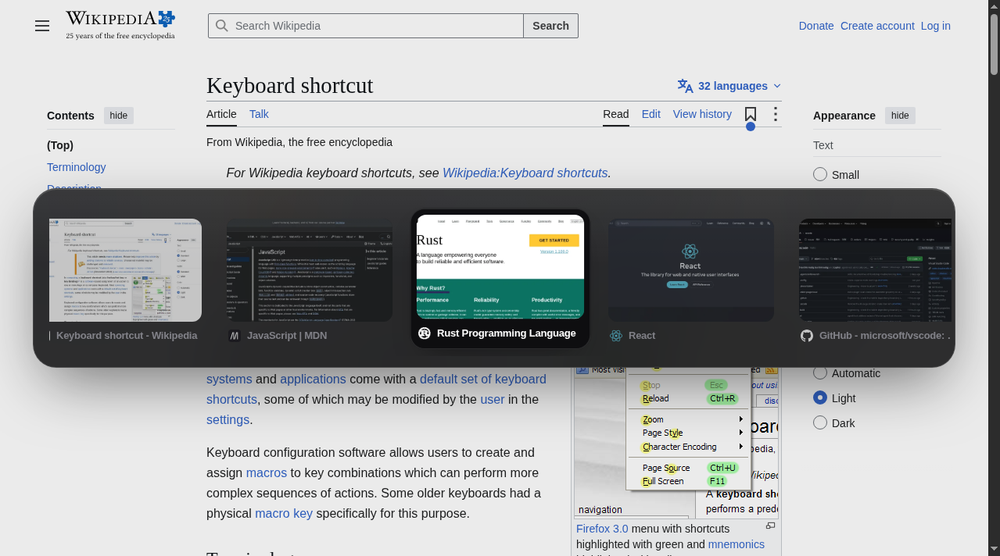
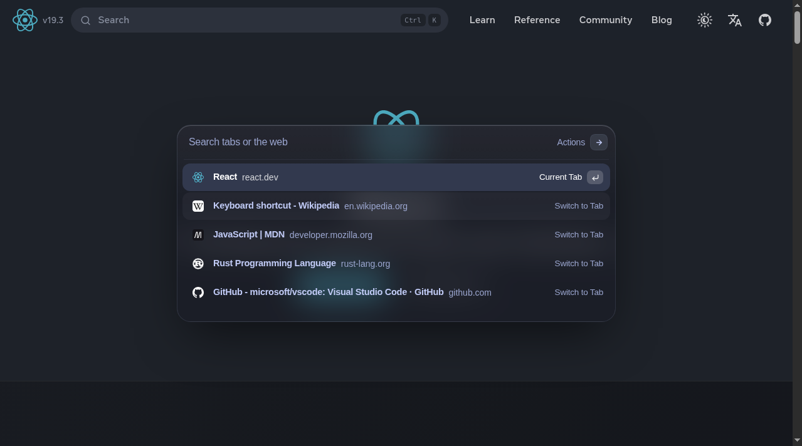
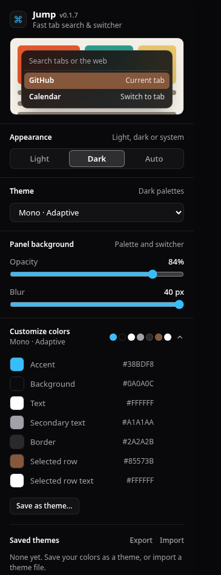
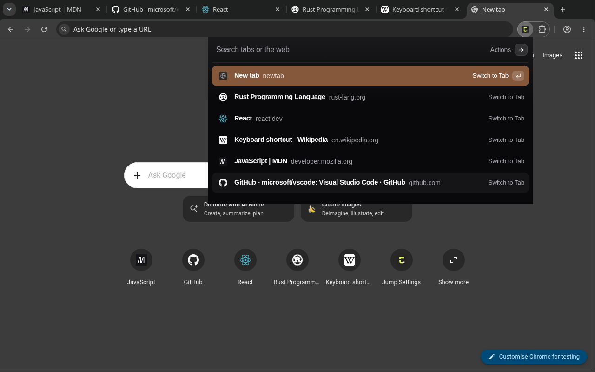
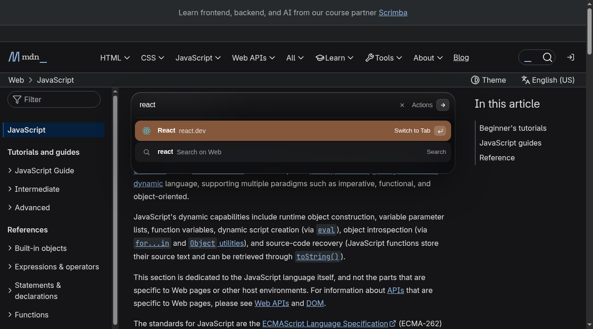

# Jump (fork)

A keyboard-first Chromium extension with two fast ways to switch tabs:

- **Thumbnail switcher**: press `Alt+Q` to browse open tabs visually.
- **Search palette**: press `⌘ Shift P` on macOS or `Ctrl Shift P` on Windows/Linux to search open tabs or run a web search.

This is a fork of [DeepanshuMishraa/jump](https://github.com/DeepanshuMishraa/jump) with more customization, support for protected pages, better keyboard handling and faster opening. The [Chrome Web Store version](https://chromewebstore.google.com/detail/aphoamhbckckomhmpfgedaeppkcloaio) is the original extension, without these changes; to use the fork, [build it from source](#install).



## What the fork adds

### Panel background: opacity and blur

Two sliders set how see-through the palette and switcher are, and how much the page behind them is blurred. Only the background fades; text and icons stay fully opaque.



### Your own colors

- **Light, Dark or Auto**: Auto follows the system setting, with a separate theme for each.
- **Color pickers** for accent, background, text, border and the selected row, on top of any preset theme.
- **Saved themes**: save your colors as a named theme, and export or import themes as files.



### Works on protected pages

Chrome doesn't let extensions draw on its own pages (New Tab, `chrome://settings`, the Web Store). On those pages the shortcuts open the palette in the toolbar popup instead. It's the same palette, with your theme and settings, so `Ctrl+T` then the search shortcut still works without the mouse.



### Keyboard stays in the palette

Sites that grab the keyboard (ChatGPT, web IDEs, pages with embedded frames) no longer steal keys or focus while the palette is open. Typing, arrows and Enter always go to Jump.

### Close tabs from the palette

- **Middle click** a tab in the search list or the switcher to close it. The palette stays open.
- **Close tab command**: with the palette open it closes the selected tab, otherwise the current tab. It has no default key; bind it yourself (for example to `Ctrl+W`) at `chrome://extensions/shortcuts`.

### Faster

- The palette is preloaded in every tab and opens in under 1 ms.
- Tab thumbnails are captured ahead of time, not when the switcher opens.
- The switcher draws only the cards you can see, so it stays quick with many tabs.



## Install

Requirements: Node.js 22.18+ and [pnpm](https://pnpm.io/installation).

```sh
pnpm install
pnpm build
```

1. Open `chrome://extensions`.
2. Enable **Developer mode**.
3. Click **Load unpacked** and select this project’s `dist` folder.

After rebuilding, click **Reload** on the extension. Refresh open tabs to inject the latest content script.

## Shortcuts

Change any shortcut at `chrome://extensions/shortcuts`.

| Command | Default |
|---|---|
| Search palette | `Ctrl+Shift+P` (`⌘+Shift+P` on macOS) |
| Thumbnail switcher | `Alt+Q` |
| Pin or unpin the selected tab | `Alt+K` (`⌘+K` on macOS) |
| Bookmark manager | `Alt+B` |
| Close tab | not set |

`Alt+Q` is the switcher default because Chrome may reject `Ctrl+Tab` as an extension shortcut. You can try assigning `Ctrl+Tab` yourself.
